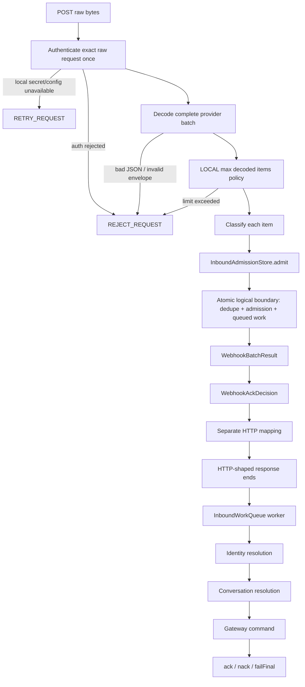

# Durable Webhook Ingress & ACK Semantics Offline — Meta WhatsApp Official API

THIS PHASE DOES NOT CONNECT WHATSAPP.

F1B-10 defines an **offline, provider-facing admission architecture** for authenticated Meta webhook requests. It does not configure a public server, production persistence, a worker runtime, credentials, WABA subscription, transport, Firebase, VPS, or any live network path.

## 1. Scope and provenance

The phase implements and tests:

- one authenticated HTTP request → one decoded provider batch → N independent items;
- request/envelope validation separated from item invalid/unsupported outcomes;
- item-level idempotency through a conceptual atomic admission boundary;
- admission record + queued work becoming visible together;
- downstream work processing after the HTTP decision;
- LOCAL `WebhookAckDecision` policy separated from HTTP status mapping;
- replay/crash semantics with in-memory reference storage only;
- a LOCAL `maxDecodedItemsPerRequest` safety boundary;
- privacy-safe audit behavior.

`ACKNOWLEDGE`, `RETRY_REQUEST`, and `REJECT_REQUEST` are **LOCAL PROCESSING POLICY** only. They are not claims about current Meta delivery/retry behavior.

Current Meta ACK/retry behavior remains blocked by:

`META_ACK_RETRY_SEMANTICS_CURRENT_RECONFIRMATION_REQUIRED`

Archived/current protocol evidence from earlier phases is not upgraded by this phase.

## 2. Request pipeline



The HTTP path does **not** perform Contact or Conversation resolution.

## 3. Item dispositions

Each decoded item receives exactly one local disposition:

- `ADMITTED` — new item; admission record and queued work were committed together;
- `DUPLICATE` — an admission already exists and must not create a second work item;
- `ALREADY_PROCESSING` — the original work item is currently reserved/processing;
- `FINAL_REJECTED` — a durable final state or invalid item prevents admission;
- `UNSUPPORTED` — the provider item is structurally recognized but unsupported locally;
- `RETRYABLE_FAILURE` — local admission infrastructure failed before the handler could rely on admission.

Source coordinates (`entryIndex`, `changeIndex`, `itemIndex`) are diagnostic only. They are never idempotency keys or business identifiers.

## 4. Atomic admission contract

`InboundAdmissionStore.admit()` is the conceptual durability boundary.

For a new event, the implementation must make these two facts visible together:

1. the idempotency/admission record exists;
2. the corresponding work item exists in the inbound queue.

It must never publish `COMPLETED`/dedupe state first and stage work later.

### Crash before commit

```text
request → admission attempt → crash before commit
                          ↓
                 no admission record
                 no queued work
                          ↓
replay may admit the event
```

### Crash after commit / response loss

```text
request → admission + queued work committed → crash/response lost
                                      ↓
replay sees existing admission
                                      ↓
no second work item is created
```

The in-memory reference models this by building replacement maps and publishing admission + queued work through one state assignment. This is a semantic model, not production durability.

## 5. Inbound work queue

`InboundWorkQueue` exposes the reference worker contract:

- `enqueue`
- `reserve`
- `ack`
- `nack`
- `failFinal`
- `get`
- `list` (reference inspection helper)

Work states are:

`QUEUED → RESERVED → COMPLETED`

or, on failure:

`RESERVED → FAILED_RETRYABLE → RESERVED ... → FAILED_FINAL`

Lease and retry timing are LOCAL worker policy. Existing provider-neutral retry mathematics from `retryPolicy.ts` is reused.

The queued `NormalizedChannelEvent` is a **sensitive payload boundary**. It may contain customer/provider address and message content and must not be serialized to audit logs, metrics, HTTP bodies, idempotency errors, or provider-facing responses.

## 6. ACK decision and HTTP mapping

Provider-neutral local decision:

```typescript
type WebhookAckDecision =
  | 'ACKNOWLEDGE'
  | 'RETRY_REQUEST'
  | 'REJECT_REQUEST';
```

Local batch policy:

- any `RETRYABLE_FAILURE` → `RETRY_REQUEST`;
- all items `ADMITTED`, `DUPLICATE`, `ALREADY_PROCESSING`, `FINAL_REJECTED`, or `UNSUPPORTED` → `ACKNOWLEDGE`;
- authentication rejection, malformed JSON, invalid envelope, invalid trust boundary, or local request-policy violation → `REJECT_REQUEST`;
- missing local secret/config or request-level infrastructure failure → `RETRY_REQUEST`.

Only after the decision exists does `mapWebhookAckDecisionToHttp()` produce an HTTP-shaped local result. HTTP status values are therefore not stored in admission records.

No statement in this section means that Meta currently retries, suppresses retries, or interprets these exact statuses in a particular way. That behavior requires current official reconfirmation.

## 7. Batch/replay examples

Mixed result:

```text
A → ADMITTED
B → DUPLICATE
C → RETRYABLE_FAILURE

request decision = RETRY_REQUEST
```

On replay:

```text
A → DUPLICATE
B → DUPLICATE
C → may become ADMITTED

request decision = ACKNOWLEDGE
```

Already-admitted replay is acknowledged by local policy because the original queued work still exists.

## 8. Decoder isolation

The batch decoder traverses all `entry[]`, `changes[]`, `messages[]`, and `statuses[]` items.

- malformed request/envelope structure rejects the request;
- recognized unsupported message/status types become `UNSUPPORTED` items;
- malformed child message/status items become item-level `FINAL_REJECTED` candidates without discarding independent valid siblings;
- message and status source coordinates use one monotonically increasing `itemIndex` inside the same change, preventing diagnostic coordinate collisions;
- provider timestamps, request receive time, and local processing sequence remain distinct.

## 9. Offline tests required by F1B-10

The phase must prove at least:

- multi-message batch;
- mixed message/status batch;
- per-item duplicate isolation;
- unsupported + valid sibling isolation;
- malformed child + valid sibling isolation;
- local decoded-item limit;
- mixed partial admission failure and safe replay;
- crash-before-commit replay;
- crash-after-commit/response-loss replay;
- replay storm with one work item only;
- source-coordinate uniqueness within a change;
- decoupled worker processing after ACK decision;
- identity/conversation resolution only in downstream worker;
- audit/secret/PII sanitization;
- F1B-09 security regression coverage;
- no network/database/live transport integration.

## 10. Production status

The following remain NOT_CONFIGURED / NOT_READY:

- production `InboundAdmissionStore`;
- production `InboundWorkQueue`;
- public HTTPS runtime;
- worker process/runtime;
- real secret provisioning;
- live Meta transport;
- WABA subscription/configuration;
- current Meta ACK/retry semantic reconfirmation;
- deployment hardening and observability.

F1B-10 is an offline architecture and reliability foundation only.
